# Educat E-Learning Platform - Use Case Diagram

මෙම Use Case Diagram එකෙහි පද්ධතියේ සීමාව (Boundary) තවත් පුළුල් කර, වඩාත් විස්තරාත්මක Use Cases ඇතුළත් කර ඇත. එමෙන්ම **SubAdmin** අලුතින් Actor කෙනෙකු ලෙස එක් කර ඇත. මෙහිදී Admin හට SubAdmin ගේ සියලුම කාර්යයන් කළ හැකි බැවින්, එය (Inheritance/Generalization) හරහා දක්වා ඇත.

පහත දැක්වෙන්නේ යාවත්කාලීන කළ **PlantUML** කේතයයි.

```plantuml
@startuml
left to right direction
skinparam packageStyle rectangle

' Actors
actor "Student" as student
actor "Teacher" as teacher
actor "Sub Admin" as subadmin
actor "Admin" as admin

' Admin inherits from SubAdmin (Admin can do everything a SubAdmin does)
subadmin <|-- admin

rectangle "Educat E-Learning Platform System Boundary" {
  
  ' Authentication & Profile
  usecase "Register, Login & Forgot Password" as UC_Auth
  usecase "Manage Profile Settings" as UC_Profile
  
  ' Student Specific
  usecase "Browse & Search Courses" as UC_BrowseCourses
  usecase "Enroll in Courses" as UC_Enroll
  usecase "Make Payments (Gateways)" as UC_Pay
  usecase "Attend Live Virtual Classes" as UC_VirtualClass
  usecase "View Recorded Lectures" as UC_Lectures
  usecase "Download Course Materials" as UC_Materials
  usecase "Submit Assignments" as UC_SubmitAssig
  usecase "Attempt Quizzes & Exams" as UC_Quizzes
  usecase "Provide Course Reviews" as UC_Reviews
  
  ' Teacher Specific
  usecase "Create & Manage Courses" as UC_ManageCourses
  usecase "Upload Video & Materials" as UC_Upload
  usecase "Schedule & Conduct Live Classes" as UC_ConductClass
  usecase "Create Quizzes & Assignments" as UC_CreateAssig
  usecase "Grade Student Submissions" as UC_Grade
  usecase "Post Advertisements" as UC_PostAds
  usecase "View Teacher Analytics & Earnings" as UC_TeacherAnalytics
  
  ' Communication
  usecase "Participate in Chat (Student/Teacher/Admin)" as UC_Chat
  
  ' Sub Admin Specific
  usecase "Verify & Approve Teachers" as UC_VerifyTeacher
  usecase "Manage User Accounts (Students/Teachers)" as UC_ManageUsers
  usecase "Handle Support & Escalations" as UC_Support
  usecase "Manage Advertisements & Announcements" as UC_ManageAds
  usecase "Monitor System Logs" as UC_Logs
  
  ' Admin Specific
  usecase "Manage Sub-Admins / Team" as UC_ManageTeam
  usecase "Manage Platform Settings" as UC_Settings
  usecase "Approve Teacher Payouts & Slips" as UC_Payouts
  usecase "Manage Promo Codes" as UC_Promos
  usecase "View Advanced System Analytics" as UC_AdminAnalytics
}

' Student Relationships
student --> UC_Auth
student --> UC_Profile
student --> UC_BrowseCourses
student --> UC_Enroll
student --> UC_Pay
student --> UC_VirtualClass
student --> UC_Lectures
student --> UC_Materials
student --> UC_SubmitAssig
student --> UC_Quizzes
student --> UC_Reviews
student --> UC_Chat

' Teacher Relationships
teacher --> UC_Auth
teacher --> UC_Profile
teacher --> UC_ManageCourses
teacher --> UC_Upload
teacher --> UC_ConductClass
teacher --> UC_CreateAssig
teacher --> UC_Grade
teacher --> UC_PostAds
teacher --> UC_TeacherAnalytics
teacher --> UC_Chat

' SubAdmin Relationships
subadmin --> UC_Auth
subadmin --> UC_Profile
subadmin --> UC_VerifyTeacher
subadmin --> UC_ManageUsers
subadmin --> UC_Support
subadmin --> UC_ManageAds
subadmin --> UC_Logs
subadmin --> UC_Chat

' Admin Relationships (Admin gets all subadmin uses cases automatically through the inheritance line)
admin --> UC_ManageTeam
admin --> UC_Settings
admin --> UC_Payouts
admin --> UC_Promos
admin --> UC_AdminAnalytics

@enduml
```

### අලුතින් එක් කරන ලද දේවල්:
1. **SubAdmin Actor:** SubAdmin ව අලුතින් එකතු කර ඇති අතර, ගුරුවරුන් verify කිරීම (Verify Teachers), පරිශීලකයන් කළමනාකරණය, escalations සහ support හැසිරවීම වැනි දේවල් ඔහුට පවරා ඇත.
2. **Admin Inheritance (Generalization):** රූපයේ `subadmin <|-- admin` මඟින් කියවෙන්නේ SubAdmin ට කළ හැකි සියලු දේ Admin ට ද කළ හැකි බවයි. එමනිසා එම රේඛා නැවත Admin ගෙන් ඇඳීම අනවශ්‍ය වේ (මෙය Standard UML notation ක්‍රමයයි). ඒ වෙනුවට Admin ට පමණක් කළ හැකි විශේෂිත දේවල් (Payments, Settings, Manage SubAdmins) වෙන් කර ඇත.
3. **පද්ධතියේ සීමාව පුළුල් කිරීම (Broader System Boundary):** පෙර තිබූ Use cases තවත් කුඩා කොටස් වලට කඩා වඩාත් විස්තරාත්මකව දක්වා ඇත. (උදා: View lectures, Download materials, Verify teachers, Handle escalations වැනි දේවල් අලුතින් එකතු කර ඇත).

ඔබට මෙය නැවතත් [PlantText](https://www.planttext.com/) හරහා රූපයක් කරගත හැක.
